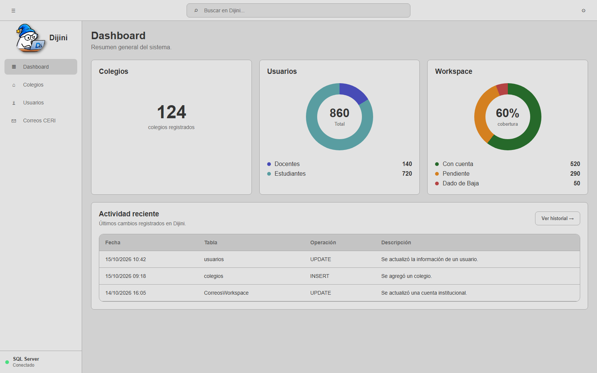

<p align="center">
  
</p>

# Dijini

Aplicación de escritorio para centralizar la gestión de colegios, usuarios y cuentas de correo institucionales.

## Dashboard



*Captura ilustrativa; las cifras y la actividad mostradas son datos de ejemplo.*


## Funcionalidades

- **Dashboard:** resumen de colegios y usuarios registrados, cobertura de cuentas Workspace y actividad reciente.
- **Gestión de colegios:** consulta, búsqueda, creación, edición y eliminación de colegios.
- **Gestión de usuarios:** consulta, búsqueda, creación, edición y eliminación de usuarios, con asociación a colegios.
- **Correos institucionales:** administración de cuentas Workspace asociadas a usuarios o colegios, con fechas de alta y baja.
- **Búsqueda global:** localización de información desde la aplicación.
- **Historial:** consulta de los cambios registrados en la base de datos.
- **Estado de la base de datos:** visualización del estado de conexión y la información de Microsoft SQL Server.

## Tecnologías

- Electron
- Node.js
- JavaScript
- HTML y CSS
- Microsoft SQL Server

## Instalación y base de datos

### Instalar el proyecto

Desde la carpeta raíz del proyecto, ejecutar:

```bash
npm install
```

### Base de datos

Por el momento, la aplicación utiliza una base de datos Microsoft SQL Server ejecutada localmente. Para usarla, es necesario tener SQL Server instalado y la base de datos `ceri_log` disponible en el equipo.

## Versión estable

**v1.0.1**
